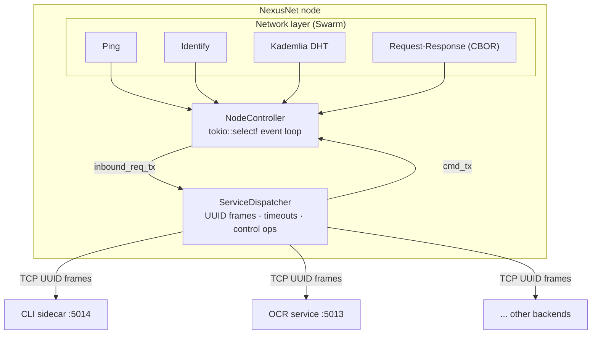

# NexusNet

**A language-agnostic libp2p networking layer for services that need to find and call each other without a central server.**

NexusNet joins a machine to a decentralized P2P network: Kademlia DHT for discovery and service registration, WebSocket transport, NAT traversal through Circuit Relay v2, and a small sidecar protocol so the business process can stay in any language.

It is the networking layer of the OAHD project, packaged as a reusable binary and Rust library.

[Why](#why-nexusnet) · [Quickstart](#quickstart) · [Architecture](#architecture) · [Features](#features) · [Compatibility](#compatibility) · [Documentation](#documentation)

## Why NexusNet

- **No central directory.** Nodes discover each other through a Kademlia DHT; service providers publish provider records and callers resolve them at call time.
- **Backend stays yours.** NexusNet runs as a sidecar and talks to a local process over a persistent TCP connection using a small CBOR protocol. The backend can be Go, Python, Rust, or anything that can frame CBOR.
- **Works without a public IP.** Circuit Relay v2 lets single-stack or NATed nodes join and serve traffic through a dual-stack bootstrap node.
- **Security is built in, not bolted on.** Optional COSE_Sign1 service authorization and hybrid post-quantum encryption (ML-KEM-768 + X25519, optional ML-DSA-65 identity).
- **Operable.** Native Debian package with systemd and a setup wizard, plus a Windows service installer.

## Quickstart

Requires Rust 1.85 or newer (`edition = "2024"`). `rust-toolchain.toml` pins a stable toolchain with `rustfmt` and `clippy`.

```bash
git clone https://git.oahd.cn/git/rplague/NexusNet.git
cd NexusNet

# one node, prints its PeerId, runs until Ctrl-C
cargo run --example basic_node

# two nodes in one process: a provider with an echo backend and a caller
cargo run --example two_nodes
```

The examples use loopback addresses and temporary directories, so they do not need a public IP or any global configuration. `two_nodes` prints the provider PeerId, the caller PeerId, and the echoed payload.

To run the daemon itself:

```bash
cargo run
```

On first run it creates `./config.toml` and `./keypair.bin` in the working directory. Environment variables (`NEXUSNET_CONFIG_PATH`, `NEXUSNET_KEYPAIR_PATH`, `NEXUSNET_LOG_PATH`, `NEXUSNET_LOG_MODE`) let a host relocate them.

## Architecture



The node is a microkernel plus sidecars:

- **`NodeController`** owns one async event loop that handles Ping, Identify, Kademlia, request-response and backend control commands.
- **`ServiceDispatcher`** keeps persistent TCP connections to every configured local backend, reconnects with exponential backoff, and forwards inbound P2P requests to the matching backend.
- **Service registry** runs as a separate actor: announcements, withdrawals and the `/oahd/service/types` lease are reconciled without blocking the controller.
- **Backpressure everywhere.** Bounded queues mean overload returns an explicit error instead of growing without limit. Sizes and details are in [docs/architecture.md](./docs/architecture.md).

## Features

| Capability | What you get | Details |
|---|---|---|
| Discovery | Kademlia provider records, RTT-ranked provider selection | [docs/service-registry.md](./docs/service-registry.md) |
| Service registry | Type index with leases, automatic re-announce, relay gating | [docs/service-registry.md](./docs/service-registry.md) |
| Backend protocol | Persistent TCP, CBOR messages, UUID correlation, 30 s default timeout | [docs/sidecar.cddl](./docs/sidecar.cddl) |
| NAT traversal | Circuit Relay v2, reservations, relay-aware announcements | [docs/nat-relay.md](./docs/nat-relay.md) |
| Authorization | COSE_Sign1 whitelists, TUF-lite rollback/freeze/mix-and-match checks | [docs/auth.md](./docs/auth.md) |
| Post-quantum | ML-KEM-768 + X25519 hybrid KEM, ChaCha20-Poly1305, optional ML-DSA-65 | [docs/architecture.md](./docs/architecture.md#post-quantum-layer) |
| Transport | WebSocket over HTTP, TLS with Noise fallback, Yamux | this file |
| Packaging | Debian package + systemd + whiptail wizard, Windows service installer | [deploy/README.md](./deploy/README.md) |

## Configuration

`config.toml` is TOML. Missing fields are filled with defaults and written back atomically on startup.

```toml
[node]
name = "my-node"
description = "my service node"

[network]
ipv4_enabled = true
port = 5000

[[services.dispatcher.local_services]]
name = "cmd"
port = 5014
require_auth = false
```

The node always connects to `127.0.0.1:<port>` for local backends. Bootstrap addresses must use the WebSocket form, for example `/ip6/2001:db8::1/tcp/5000/ws/p2p/<PeerId>`.

## Backend protocol

The node and backend exchange length-prefixed CBOR over a persistent TCP connection:

```text
u32_be(len) || cbor(message)      # len <= 16 MiB
```

The first frame in both directions is `hello { version }`. Requests use `request { id, service, payload }` and replies use `reply { id, ok, result?, error? }`; correlation ids are UUIDs. The full CDDL contract is in [docs/sidecar.cddl](./docs/sidecar.cddl).

## Compatibility

NexusNet is at **0.6.2-11020** and roughly **6/10** completeness. Treat the interfaces as stabilizing, not frozen.

- **WebSocket-only since 0.6.x.** Raw TCP peers from older versions cannot connect; upgrade every node together.
- **`/oahd/service/types` changed format without a version bump.** New nodes read both formats but always write the tuple form. Stop old writers before upgrading the rest of the network; there is no rolling compatibility.
- **Record size limit.** `compat.max_record_bytes` defaults to 14 KiB so records still fit older 16 KiB Kademlia packets. Raise it only after every node is upgraded.
- **Toolchain.** `edition = "2024"` requires Rust 1.85+.

## Documentation

- [Architecture and internals](./docs/architecture.md)
- [Service registry state machine](./docs/service-registry.md)
- [NAT and relay behavior](./docs/nat-relay.md)
- [Authorization contract](./docs/auth.md)
- [Sidecar protocol CDDL](./docs/sidecar.cddl)
- [Deployment and packaging](./deploy/README.md)
- [中文说明](./README.zh-CN.md)

## Contributing and security

See [CONTRIBUTING.md](./CONTRIBUTING.md) for the local development workflow and [SECURITY.md](./SECURITY.md) for how security issues are handled and disclosed.

## License

GNU General Public License v3.0. See [LICENSE](./LICENSE).

This program is distributed in the hope that it will be useful, but **without any warranty**; without even the implied warranty of merchantability or fitness for a particular purpose.
