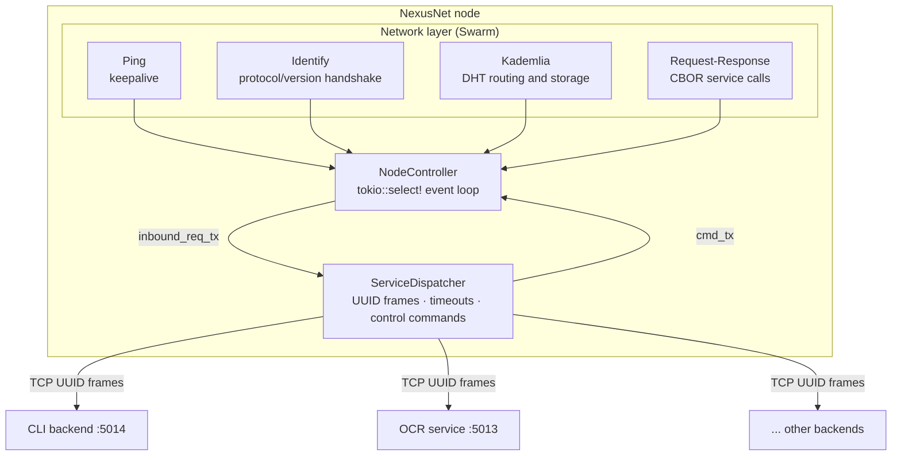

# NexusNet

A language-agnostic libp2p networking layer for services that need to find and call each other without a central server.

[English](./README.md) · [中文](./README.zh-CN.md)

NexusNet joins a machine to a decentralized P2P network: Kademlia DHT for discovery and service registration, WebSocket transport, NAT traversal through Circuit Relay v2, and a small sidecar protocol so the business process can stay in any language.

**Status:** `0.6.2-11020` · roughly 6/10 completeness · interfaces are stabilizing, not frozen.

[Why](#why-nexusnet) · [Quickstart](#quickstart) · [Architecture](#architecture) · [Features](#features) · [Configuration](#configuration) · [Compatibility](#compatibility-and-status) · [Documentation](#documentation)

## Why NexusNet

- **No central directory.** Nodes discover each other through a Kademlia DHT; service providers publish provider records and callers resolve them at call time.
- **Backend stays yours.** NexusNet runs as a sidecar and talks to a local process over a persistent TCP connection using a small CBOR protocol. The backend can be Go, Python, Rust, or anything that can frame CBOR.
- **Works without a public IP.** Circuit Relay v2 lets single-stack or NATed nodes join and serve traffic through a dual-stack bootstrap node.
- **Security is built in, not bolted on.** Optional COSE_Sign1 service authorization and hybrid post-quantum encryption (ML-KEM-768 + X25519, optional ML-DSA-65 identity).
- **Operable.** Native Debian package with systemd and a setup wizard, plus a Windows service installer.

## Quickstart

Requires Rust 1.85 or newer (`edition = "2024"`). `rust-toolchain.toml` pins a stable toolchain with `rustfmt` and `clippy`.

```bash
git clone https://git.oahd.cn/git/rplague/NexusNet.git
cd NexusNet

# one node, prints its PeerId, runs until Ctrl-C
cargo run --example basic_node

# two nodes in one process: a provider with an echo backend and a caller
cargo run --example two_nodes
```

The examples use loopback addresses and temporary directories, so they do not need a public IP or any global configuration. `two_nodes` prints the provider PeerId, the caller PeerId, and the echoed payload.

To run the daemon itself:

```bash
cargo run
```

On first run it creates `./config.toml` and `./keypair.bin` in the working directory. Environment variables (`NEXUSNET_CONFIG_PATH`, `NEXUSNET_KEYPAIR_PATH`, `NEXUSNET_LOG_PATH`, `NEXUSNET_LOG_MODE`) let a host relocate them. See [docs/configuration.md](./docs/configuration.md) for the full reference.

## Architecture



The node is a microkernel plus local backends (the sidecar pattern):

| Component | Role |
|---|---|
| `NodeController` | Single async event loop for Ping, Identify, Kademlia, request-response and backend control commands |
| `ServiceDispatcher` | Persistent backend TCP connections, readiness, exponential backoff reconnects and request forwarding |
| `ServiceRegistryActor` | Announcements, withdrawals and the `/oahd/service/types` lease, reconciled asynchronously |
| `SwarmActor` | The only task that owns the libp2p `Swarm` |
| `AuthGate` | COSE_Sign1 verification and fail-closed authorization decisions |
| `DhtCache` | Read-through cache with per-key single-flight refresh |

Every queue is bounded, so overload returns an explicit error instead of growing without limit. Startup order, queue sizes, the request path and deeper internals are in [docs/architecture.md](./docs/architecture.md).

## Features

| Capability | What you get | Details |
|---|---|---|
| Discovery | Kademlia provider records, RTT-ranked provider selection | [docs/service-registry.md](./docs/service-registry.md) |
| Service registry | Type index with leases, automatic re-announce, relay gating | [docs/service-registry.md](./docs/service-registry.md) |
| Sidecar protocol | Persistent TCP, CBOR messages, UUID correlation, 30 s default timeout | [docs/sidecar.cddl](./docs/sidecar.cddl) |
| NAT traversal | Circuit Relay v2, reservations, relay-aware announcements | [docs/nat-relay.md](./docs/nat-relay.md) |
| Authorization | COSE_Sign1 whitelists, TUF-lite rollback/freeze/mix-and-match checks | [docs/auth.md](./docs/auth.md) |
| Post-quantum | ML-KEM-768 + X25519 hybrid KEM, ChaCha20-Poly1305, optional ML-DSA-65 | [docs/architecture.md](./docs/architecture.md#post-quantum-layer) |
| Transport | WebSocket over HTTP, TLS with Noise fallback, Yamux | [docs/nat-relay.md](./docs/nat-relay.md) |
| Packaging | Debian package + systemd + whiptail wizard, Windows service installer | [deploy/README.md](./deploy/README.md) |

## Configuration

`config.toml` is TOML. Missing fields are filled with defaults and written back atomically on startup; existing values, unknown fields, comments and array-of-table entries are preserved.

```toml
[node]
name = "my-node"
description = "my service node"

[network]
ipv4_enabled = true
port = 5000

[[services.dispatcher.local_services]]
name = "cmd"
port = 5014
require_auth = false
```

| Section | Key settings |
|---|---|
| `[node]` | `name`, `description`, `allow_bootstrap`, `accept_bootstrap_providers` |
| `[network]` | `ipv4_enabled` / `ipv6_enabled`, addresses, `port`, `force_relay` |
| `[services.ping]` | `interval_secs`, `with_timeout`, `max_failures` |
| `[services.kademlia]` | record/provider TTLs, `replication_factor`, `query_timeout_seconds`, `bootstrap_nodes` |
| `[services.dispatcher]` | `query_timeout_secs`, `types_sync_secs`, `max_inflight_dht`, message size limits, `local_services` |
| `[services.registry]` | `max_inflight_dht`, `type_ttl_secs` |
| `[services.relay]` | `retry_interval_secs`, `max_failures` |
| `[compat]` | `max_record_bytes` |
| `[crypto]` | `pq_transport_enabled`, `pq_identity_enabled`, `pq_required` |
| `[auth]` | `network`, `networks.<name>.authority` |

The node always connects to `127.0.0.1:<port>` for local backends. Bootstrap addresses must use the WebSocket form, for example `/ip6/2001:db8::1/tcp/5000/ws/p2p/<PeerId>`.

Environment variables: `NEXUSNET_CONFIG_PATH`, `NEXUSNET_KEYPAIR_PATH`, `NEXUSNET_LOG_PATH`, `NEXUSNET_LOG_MODE`. Unset variables fall back to the working directory.

Full field defaults, TTL constraints, message limits and installer modes: [docs/configuration.md](./docs/configuration.md).

## Sidecar protocol

The node and backend exchange length-prefixed CBOR over a persistent TCP connection:

```text
u32_be(len) || cbor(message)      # len <= 16 MiB
```

The first frame in both directions is `hello { version }`; incompatible versions disconnect.

| `t` | Direction | Purpose |
|---|---|---|
| `hello` | both | Handshake and version negotiation |
| `request` | node → backend | Forward an inbound service request `{ id, service, payload }` |
| `reply` | both | Correlated reply `{ id, ok, result?, error? }` |
| `list_services`, `discover_providers`, `query_public_ip`, `whoami`, `reconnect_bootstrap`, `reannounce_services`, `reload_config`, `refresh_cache`, `relay_status`, `pq_status`, `auth_status`, `query_key`, `add_key`, `remove_key`, `service_request`, `service_request_to` | backend → node | Control commands answered with `reply` |

Correlation ids are UUIDs; `reply.result` is operation-specific CBOR bytes. The default timeout is 30 seconds. The full CDDL contract is in [docs/sidecar.cddl](./docs/sidecar.cddl).

## Service discovery and registration

- Local services come from `config.services.dispatcher.local_services`. The node connects to each backend and waits for its `hello` handshake.
- A service is announced only after the backend is ready, DHT bootstrap has completed, and the node is reachable.
- A node that needs a relay does not announce until at least one circuit is active; losing the last relay withdraws every announced service.
- `start_providing` publishes `/oahd/service/<name>`. Backend disconnects enter a short grace window (about 3–4 seconds) before `stop_providing` runs.
- Provider records expire after `provider_record_ttl_seconds` (default 3600 s) and active providers republish every `provider_publication_interval_seconds` (default 1800 s).
- The service type index at `/oahd/service/types` uses leases (`type_ttl_secs`, default 1800 s) and is reconciled every `types_sync_secs` (default 300 s).
- `BootstrapCompleted` and `reannounce_services` clear the local `announced` state and re-announce, so a rebuilt DHT does not stay stale.
- `service_request` prefers a ready local backend and skips DHT, PQ and the auth gate; otherwise it resolves providers and ranks candidates by RTT.
- DHT reads use a read-through cache with per-key single-flight refresh. Authorization still checks `expires_at` and `version` on every decision.

The full state machine is in [docs/service-registry.md](./docs/service-registry.md).

## NAT and relay

```text
        [B: dual-stack public bootstrap + relay]
          ^                 ^
          |                 |
     [E: NAT node]      [A: caller]
```

A NATed node needs no public IP. It reserves a `p2p-circuit` on a dual-stack bootstrap/relay, announces only after the first relay is ready, and withdraws when the last relay disappears.

| Event | Behavior |
|---|---|
| First relay becomes ready | `start_providing` |
| Relay count grows (1 → 2/3) | Services stay announced |
| One relay fails (2 → 1) | Services stay announced; callers try the remaining addresses |
| Last relay fails (1 → 0) | `stop_providing` for every local service |
| Relay returns | `start_providing` again |

`relay_status` returns:

| Field | Meaning |
|---|---|
| `need_relay` | True for single-stack or public-address-less nodes |
| `reachability` | `public` / `relay` / `none` |
| `active_relays` | Ready relay PeerIds |
| `pending_relays` | Relay PeerIds with a reservation in progress |

Relay servers size `max_circuit_bytes` as `max_request_bytes + max_response_bytes`, so bootstrap limits must be at least as large as their clients'. Details and address resolution are in [docs/nat-relay.md](./docs/nat-relay.md).

## Security

### Post-quantum

Service calls use `/oahd/service_req/2.0.0` with a hybrid ML-KEM-768 + X25519 KEM, ChaCha20-Poly1305 AEAD, and optional ML-DSA-65 (FIPS 204) identity. The caller encapsulates to the responder's KEM key; both sides derive one shared key used for the request and the response. The plaintext protocol is used only when the peer is confirmed not to support PQ; unknown capability returns a retryable error instead of silently downgrading.

| Setting | Meaning |
|---|---|
| `crypto.pq_transport_enabled` | Enable encrypted service calls |
| `crypto.pq_identity_enabled` | Require and verify ML-DSA-65 signatures (requires transport) |
| `crypto.pq_required` | Reject non-PQ peers |

Keys live in `keypair.pq.bin`. See [docs/architecture.md](./docs/architecture.md#post-quantum-layer) for the protocol flow.

### Authorization

Records are COSE_Sign1/EdDSA values signed by an authority ed25519 key and stored under `/oahd/auth/<net_hash>/...`; the DHT is treated as untrusted transport. Checks are fail-closed with TUF-lite rollback, freeze and mix-and-match protection. For each inbound request the gate allows when authorization is disabled or the service does not require it; otherwise it denies on a missing or expired index, denies when the whitelist is missing or does not contain the peer, and allows with a warning when the service is absent from the index.

| Setting | Meaning |
|---|---|
| `auth.network` | Authorization network name; `"none"` disables it |
| `auth.networks.<name>.authority` | Authority ed25519 public key (base64) |
| `require_auth` | Per-service switch in `local_services` |

The byte-level contract and publishing flow are in [docs/auth.md](./docs/auth.md).

## Deployment

Production uses a native Debian package managed by `dpkg`/`apt`:

```bash
apt install -y ./nexusnet_<version>_amd64.deb
```

The installer runs a whiptail wizard, creates the `nexusnet` user, and writes `/etc/nexusnet/config.toml`.

| File | Path | Notes |
|---|---|---|
| Configuration | `/etc/nexusnet/config.toml` | Generated by the wizard; preserved on upgrade |
| Node identity | `/var/lib/nexusnet/keypair.bin` | Must not be lost; preserved on upgrade/uninstall |
| Logs | journald | Collected, rotated and retained by systemd |

Status: `systemctl status nexusnet`; logs: `journalctl -u nexusnet -f`.

Windows builds ship an NSIS installer and a portable zip, both hosting the node as a service through NSSM under `NT SERVICE\nexusnet`. Build, upgrade and uninstall details are in [deploy/README.md](./deploy/README.md).

## Logging and identity

Logging mode is detected automatically:

- **systemd**: stdout/stderr only, no files; journald handles rotation, compression and retention. Lines are single-line with a syslog level prefix, filterable with `journalctl -u nexusnet -p err`.
- **Other**: terminal plus a text file, with gzip rotation at 10 MB.
- Levels: `Critical | Error | Warning | Important | Preset | Debug`; colors are disabled when not a TTY.

Identity:

- **ED25519 primary identity** in `keypair.bin` (protobuf-encoded, derives the `PeerId`).
- **PQ auxiliary keys** in `keypair.pq.bin`.
- `keypair.bin` must not be lost; losing it changes the node identity.

## Compatibility and status

NexusNet is at **0.6.2-11020** and roughly **6/10** completeness. Treat the interfaces as stabilizing, not frozen.

- **WebSocket-only since 0.6.x.** Raw TCP peers from older versions cannot connect; upgrade every node together.
- **`/oahd/service/types` changed format without a version bump.** New nodes read both formats but always write the tuple form. Stop old writers before upgrading the rest of the network; there is no rolling compatibility.
- **Sidecar protocol v2.** Both sides send `hello { version }` first and disconnect on a version mismatch.
- **Record size limit.** `compat.max_record_bytes` defaults to 14 KiB so records still fit older 16 KiB Kademlia packets. Raise it only after every node is upgraded.
- **Toolchain.** `edition = "2024"` requires Rust 1.85+.

## Documentation

The Markdown documents under `docs/` are bilingual; `docs/sidecar.cddl` keeps Chinese comments.

- [Architecture and internals](./docs/architecture.md)
- [Configuration reference](./docs/configuration.md)
- [Service registry state machine](./docs/service-registry.md)
- [NAT and relay behavior](./docs/nat-relay.md)
- [Authorization contract](./docs/auth.md)
- [Sidecar protocol CDDL](./docs/sidecar.cddl)
- [Deployment and packaging](./deploy/README.md)
- [中文说明](./README.zh-CN.md)

## Contributing and security

See [CONTRIBUTING.md](./CONTRIBUTING.md) for the local development workflow and [SECURITY.md](./SECURITY.md) for how security issues are handled and disclosed.

## License

GNU General Public License v3.0. See [LICENSE](./LICENSE).

This program is distributed in the hope that it will be useful, but **without any warranty**; without even the implied warranty of merchantability or fitness for a particular purpose.
