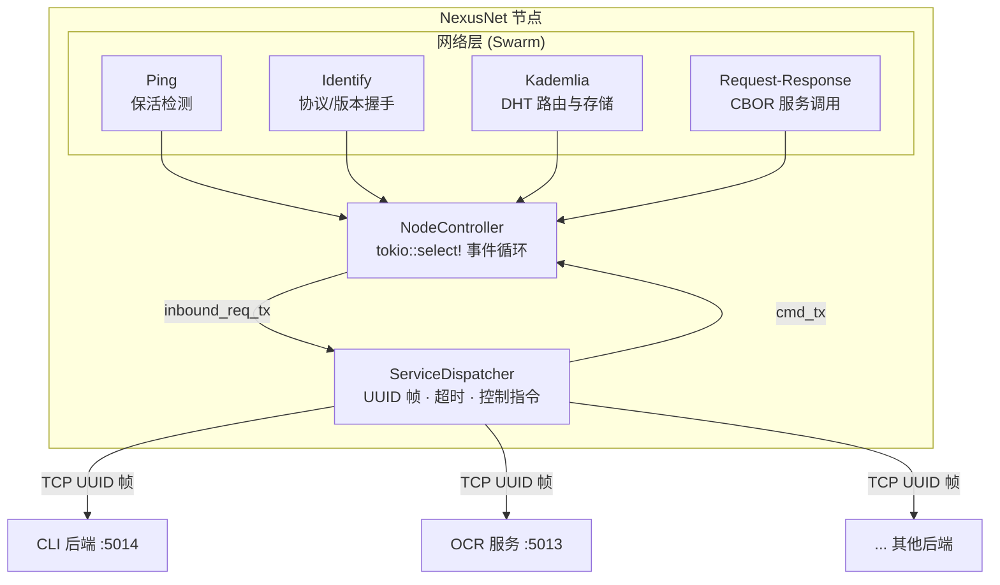

# NexusNet

面向服务的语言无关 libp2p 网络层，让服务无需中心服务器即可互相发现与调用。

[English](./README.md) · [中文](./README.zh-CN.md)

NexusNet 将一台机器接入去中心化 P2P 网络：Kademlia DHT 负责发现与服务注册，WebSocket 负责传输，Circuit Relay v2 负责 NAT 穿透，边车协议让业务进程可以用任何语言实现。

**状态：** `0.6.2-11020` · 完成度约 6/10 · 接口正在稳定，尚未冻结。

[为什么](#为什么选择-nexusnet) · [快速开始](#快速开始) · [架构](#架构) · [特性](#特性) · [配置](#配置) · [兼容性](#兼容性与状态) · [文档](#文档)

## 为什么选择 NexusNet

- **无需中心目录。** 节点通过 Kademlia DHT 互相发现；服务提供方发布 provider 记录，调用方在调用时解析。
- **后端保持自主。** NexusNet 以边车模式运行，通过持久 TCP 连接和一个小型 CBOR 协议与本地进程通信。后端可以是 Go、Python、Rust，或任何能处理 CBOR 帧的语言。
- **没有公网 IP 也能用。** Circuit Relay v2 让单栈或 NAT 后的节点通过双栈引导节点加入网络并提供服务。
- **安全内建。** 可选的 COSE_Sign1 服务鉴权和混合后量子加密（ML-KEM-768 + X25519，可选 ML-DSA-65 身份）。
- **可运维。** 原生 Debian 包、systemd 与安装向导，另有 Windows 服务安装器。

## 快速开始

需要 Rust 1.85 或更新版本（`edition = "2024"`）。`rust-toolchain.toml` 固定 stable 工具链并包含 `rustfmt` 与 `clippy`。

```bash
git clone https://git.oahd.cn/git/rplague/NexusNet.git
cd NexusNet

# 单节点，打印 PeerId，运行到 Ctrl-C
cargo run --example basic_node

# 同进程两节点：一个带 echo 后端的 provider，一个调用方
cargo run --example two_nodes
```

示例使用回环地址和临时目录，不需要公网 IP 或全局配置。`two_nodes` 会打印 provider PeerId、调用方 PeerId 以及 echo 返回的内容。

运行守护进程本身：

```bash
cargo run
```

首次运行会在工作目录生成 `./config.toml` 和 `./keypair.bin`。环境变量（`NEXUSNET_CONFIG_PATH`、`NEXUSNET_KEYPAIR_PATH`、`NEXUSNET_LOG_PATH`、`NEXUSNET_LOG_MODE`）可以改变路径。完整说明见 [docs/configuration.md](./docs/configuration.md)。

## 架构



节点采用微内核 + 后端的边车模式：

| 组件 | 职责 |
|---|---|
| `NodeController` | 单异步事件循环，处理 Ping、Identify、Kademlia、request-response 和后端控制指令 |
| `ServiceDispatcher` | 持久后端 TCP 连接、就绪状态、指数退避重连和请求转发 |
| `ServiceRegistryActor` | 宣告、撤销和 `/oahd/service/types` 租约，异步 reconcile |
| `SwarmActor` | 唯一持有 libp2p `Swarm` 的任务 |
| `AuthGate` | COSE_Sign1 验签与 fail-closed 鉴权判定 |
| `DhtCache` | 读穿透缓存，每 key 单飞刷新 |

所有队列都有界，过载时返回明确错误而不是无限增长。启动顺序、队列大小、请求路径和更深的内部实现见 [docs/architecture.md](./docs/architecture.md)。

## 特性

| 能力 | 提供什么 | 详情 |
|---|---|---|
| 发现 | Kademlia provider 记录、按 RTT 排序选择 provider | [docs/service-registry.md](./docs/service-registry.md) |
| 服务注册 | 带租约的类型索引、自动重新宣告、中继门控 | [docs/service-registry.md](./docs/service-registry.md) |
| 边车协议 | 持久 TCP、CBOR 消息、UUID 关联、默认 30 秒超时 | [docs/sidecar.cddl](./docs/sidecar.cddl) |
| NAT 穿透 | Circuit Relay v2、预约、感知中继的宣告 | [docs/nat-relay.md](./docs/nat-relay.md) |
| 鉴权 | COSE_Sign1 白名单、TUF-lite 回滚/冻结/mix-and-match 防护 | [docs/auth.md](./docs/auth.md) |
| 后量子 | ML-KEM-768 + X25519 混合 KEM、ChaCha20-Poly1305、可选 ML-DSA-65 | [docs/architecture.md](./docs/architecture.md#post-quantum-layer) |
| 传输 | WebSocket over HTTP、TLS（Noise 回退）、Yamux | [docs/nat-relay.md](./docs/nat-relay.md) |
| 打包 | Debian 包 + systemd + whiptail 向导、Windows 服务安装器 | [deploy/README.md](./deploy/README.md) |

## 配置

`config.toml` 使用 TOML。启动时缺失字段会取默认值并原子写回；已有值、未知字段、注释和数组表条目保持不变。

```toml
[node]
name = "my-node"
description = "my service node"

[network]
ipv4_enabled = true
port = 5000

[[services.dispatcher.local_services]]
name = "cmd"
port = 5014
require_auth = false
```

| 段 | 关键设置 |
|---|---|
| `[node]` | `name`、`description`、`allow_bootstrap`、`accept_bootstrap_providers` |
| `[network]` | `ipv4_enabled` / `ipv6_enabled`、地址、`port`、`force_relay` |
| `[services.ping]` | `interval_secs`、`with_timeout`、`max_failures` |
| `[services.kademlia]` | 记录/provider TTL、`replication_factor`、`query_timeout_seconds`、`bootstrap_nodes` |
| `[services.dispatcher]` | `query_timeout_secs`、`types_sync_secs`、`max_inflight_dht`、报文大小上限、`local_services` |
| `[services.registry]` | `max_inflight_dht`、`type_ttl_secs` |
| `[services.relay]` | `retry_interval_secs`、`max_failures` |
| `[compat]` | `max_record_bytes` |
| `[crypto]` | `pq_transport_enabled`、`pq_identity_enabled`、`pq_required` |
| `[auth]` | `network`、`networks.<name>.authority` |

节点固定连接 `127.0.0.1:<port>` 上的本地后端。引导地址必须使用 WebSocket 形式，例如 `/ip6/2001:db8::1/tcp/5000/ws/p2p/<PeerId>`。

环境变量：`NEXUSNET_CONFIG_PATH`、`NEXUSNET_KEYPAIR_PATH`、`NEXUSNET_LOG_PATH`、`NEXUSNET_LOG_MODE`。未设置时回退当前目录。

完整字段默认值、TTL 约束、报文上限和安装器模式见 [docs/configuration.md](./docs/configuration.md)。

## 边车协议

节点与后端通过持久 TCP 连接交换带长度前缀的 CBOR：

```text
u32_be(len) || cbor(message)      # len <= 16 MiB
```

双方首帧必须是 `hello { version }`；版本不兼容则断开。

| `t` | 方向 | 用途 |
|---|---|---|
| `hello` | 双向 | 握手与版本协商 |
| `request` | 节点 → 后端 | 转发入站服务请求 `{ id, service, payload }` |
| `reply` | 双向 | 关联回复 `{ id, ok, result?, error? }` |
| `list_services`、`discover_providers`、`query_public_ip`、`whoami`、`reconnect_bootstrap`、`reannounce_services`、`reload_config`、`refresh_cache`、`relay_status`、`pq_status`、`auth_status`、`query_key`、`add_key`、`remove_key`、`service_request`、`service_request_to` | 后端 → 节点 | 控制指令，节点以 `reply` 应答 |

关联 id 为 UUID；`reply.result` 是操作自定的 CBOR 字节。默认超时 30 秒。完整 CDDL 契约见 [docs/sidecar.cddl](./docs/sidecar.cddl)。

## 服务注册与发现

- 本地服务来自 `config.services.dispatcher.local_services`。节点连接每个后端并等待其 `hello` 握手。
- 只有后端就绪、DHT bootstrap 完成且节点可达后，服务才会被宣告。
- 需要中继的节点在至少一条电路就绪前不宣告；最后一个中继失效时撤销所有已宣告服务。
- `start_providing` 发布 `/oahd/service/<name>`。后端断开后进入短暂宽限期（约 3–4 秒），超时后执行 `stop_providing`。
- provider 记录在 `provider_record_ttl_seconds`（默认 3600 秒）后过期，活跃 provider 每 `provider_publication_interval_seconds`（默认 1800 秒）重发。
- `/oahd/service/types` 的服务类型索引使用租约（`type_ttl_secs`，默认 1800 秒），每 `types_sync_secs`（默认 300 秒）reconcile 一次。
- `BootstrapCompleted` 和 `reannounce_services` 会清空本地 `announced` 状态并重新宣告，避免 DHT 重建后停留在旧状态。
- `service_request` 优先使用就绪的本地后端，跳过 DHT、PQ 和鉴权门；否则解析 provider 并按 RTT 排序。
- DHT 读取使用读穿透缓存，每 key 单飞刷新。鉴权每次判定仍检查 `expires_at` 和 `version`。

完整状态机见 [docs/service-registry.md](./docs/service-registry.md)。

## 无公网 IP 接入（中继）

```text
        [B：双栈公网 bootstrap + 中继]
          ^                 ^
          |                 |
     [E：NAT 节点]      [A：调用方]
```

NAT 节点不需要公网 IP。它在双栈 bootstrap/中继上预约 `p2p-circuit`，第一个中继就绪后才宣告服务，最后一个中继消失时撤销宣告。

| 事件 | 行为 |
|---|---|
| 第一个中继就绪 | `start_providing` |
| 中继增加（1 → 2/3） | 服务保持宣告 |
| 单个中继失效（2 → 1） | 服务保持宣告；调用方尝试剩余地址 |
| 最后一个中继失效（1 → 0） | `stop_providing` 所有本地服务 |
| 中继重新出现 | 再次 `start_providing` |

`relay_status` 返回：

| 字段 | 含义 |
|---|---|
| `need_relay` | 单栈或无公网地址时为 true |
| `reachability` | `public` / `relay` / `none` |
| `active_relays` | 已就绪的中继 PeerId |
| `pending_relays` | 预约中的中继 PeerId |

中继服务器的 `max_circuit_bytes` 取 `max_request_bytes + max_response_bytes`，因此 bootstrap 的上限必须不小于客户端。地址解析细节见 [docs/nat-relay.md](./docs/nat-relay.md)。

## 安全

### 后量子

服务调用使用 `/oahd/service_req/2.0.0`，采用 ML-KEM-768 + X25519 混合 KEM、ChaCha20-Poly1305 AEAD，可选 ML-DSA-65（FIPS 204）身份。调用方封装到响应方的 KEM 公钥，双方派生同一个共享密钥，用于请求和响应。只有确认对端不支持 PQ 时才使用明文协议；能力未知时返回可重试错误，不会静默降级。

| 配置 | 含义 |
|---|---|
| `crypto.pq_transport_enabled` | 启用加密服务调用 |
| `crypto.pq_identity_enabled` | 要求并校验 ML-DSA-65 签名（需启用 transport） |
| `crypto.pq_required` | 强制 PQ，拒绝非 PQ 对端 |

密钥位于 `keypair.pq.bin`。协议流程见 [docs/architecture.md](./docs/architecture.md#post-quantum-layer)。

### 鉴权

记录是权威方 ed25519 密钥签名的 COSE_Sign1/EdDSA 值，存放在 `/oahd/auth/<net_hash>/...`；DHT 仅作为不可信传输。判定采用 fail-closed，并使用 TUF-lite 的回滚、冻结和 mix-and-match 防护。对每个入站请求：鉴权关闭或服务不要求鉴权时放行；否则索引缺失/过期时拒绝，白名单缺失或不包含该 peer 时拒绝，服务不在索引中时放行并记 Warning。

| 配置 | 含义 |
|---|---|
| `auth.network` | 鉴权网络名；`"none"` 表示关闭 |
| `auth.networks.<name>.authority` | 该网络的权威 ed25519 公钥（base64） |
| `require_auth` | `local_services` 中的单服务开关 |

字节级契约与发布流程见 [docs/auth.md](./docs/auth.md)。

## 部署

生产环境使用由 `dpkg`/`apt` 管理的原生 Debian 包：

```bash
apt install -y ./nexusnet_<version>_amd64.deb
```

安装器运行 whiptail 向导，创建 `nexusnet` 用户，并写入 `/etc/nexusnet/config.toml`。

| 文件 | 路径 | 说明 |
|---|---|---|
| 配置 | `/etc/nexusnet/config.toml` | 向导生成；升级时保留 |
| 节点身份 | `/var/lib/nexusnet/keypair.bin` | 不可丢失；升级/卸载时保留 |
| 日志 | journald | 由 systemd 采集、轮转和保留 |

状态：`systemctl status nexusnet`；日志：`journalctl -u nexusnet -f`。

Windows 侧提供 NSIS 安装器和便携 zip，两者都通过 NSSM 以 `NT SERVICE\nexusnet` 虚拟账号托管为服务。构建、升级和卸载详见 [deploy/README.md](./deploy/README.md)。

## 日志与节点身份

日志模式自动检测：

- **systemd**：只写 stdout/stderr，不写文件；轮转、压缩和保留交给 journald。输出为单行并带 syslog 级别前缀，可用 `journalctl -u nexusnet -p err` 过滤。
- **其他**：终端 + 文本文件双输出，文件 10 MB 触发 gzip 轮转。
- 等级：`Critical | Error | Warning | Important | Preset | Debug`；非 TTY 自动去彩色。

节点身份：

- **ED25519 主身份** 位于 `keypair.bin`（Protobuf 编码，派生 `PeerId`）。
- **PQ 辅助密钥** 位于 `keypair.pq.bin`。
- `keypair.bin` 不可丢失；丢失后节点身份会改变。

## 兼容性与状态

NexusNet 当前为 **0.6.2-11020**，完成度约 **6/10**。接口正在稳定，尚未冻结。

- **0.6.x 起只支持 WebSocket。** 旧版 raw TCP 节点无法连接；所有节点必须一起升级。
- **`/oahd/service/types` 无版本格式变更。** 新节点可读两种格式，但一律写回 tuple 格式。升级其余节点前先停止旧节点写入；不提供滚动兼容。
- **边车协议 v2。** 双方首帧必须是 `hello { version }`，版本不兼容则断开。
- **记录大小上限。** `compat.max_record_bytes` 默认 14 KiB，保证记录仍适配旧版 16 KiB Kademlia 包。全量升级后再调大。
- **工具链。** `edition = "2024"` 需要 Rust 1.85+。

## 文档

`docs/` 下的 Markdown 文档均为中英双语；`docs/sidecar.cddl` 保持中文注释。

- [架构与内部实现](./docs/architecture.md)
- [配置参考](./docs/configuration.md)
- [服务注册状态机](./docs/service-registry.md)
- [NAT 与中继行为](./docs/nat-relay.md)
- [鉴权契约](./docs/auth.md)
- [边车协议 CDDL](./docs/sidecar.cddl)
- [部署与打包](./deploy/README.md)
- [English README](./README.md)

## 贡献与安全

本地开发流程见 [CONTRIBUTING.md](./CONTRIBUTING.md)；安全问题的处理与披露方式见 [SECURITY.md](./SECURITY.md)。

## 许可

GNU General Public License v3.0，详见 [LICENSE](./LICENSE)。

本程序分发时希望它有用，但**不提供任何保证**；甚至不保证适销性或特定用途的适用性。
